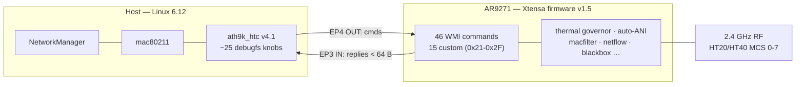

# 📡 Custom ath9k_htc Driver & Firmware — TP-Link TL-WN422G v2 (Atheros AR9271)


-success)


> A complete, measured, root-caused engineering effort to turn a cheap "54 Mbps" USB Wi-Fi stick into a
> fully instrumented research radio: **custom Xtensa firmware** (13 firmware-resident features, 15 custom WMI
> commands, a 64-byte-packet USB wedge found and fixed), a **custom driver build** (live debugfs knobs, honest
> noise-floor reads), and **host-side resilience** (a hang watchdog that earned its keep in a real hang event).
> Everything in this repo is backed by evidence: usbmon captures, register cross-decodes, and a 2× stability soak.

**العربية:** ⬇️ القسم العربي في [أسفل الصفحة](#-القسم-العربي).

---

## ✨ Highlights

| Area | What you get | Evidence |
|---|---|---|
| 🔬 **Firmware-resident features** | spectral-triggered auto-scan, thermal governor, auto-ANI v2 (firstep + CCA), RSSI histogram, radio-side MAC filter, mini-netflow, channel NF survey, Block-ACK window, rate-control runtime profiles, TX-power override, reverse telemetry events, post-mortem black box | [08](docs/08-firmware-resident-features.md), [09](docs/09-firmware-v3-batch.md), [12](docs/12-thermal-batch.md) |
| 🎛️ **Live debugfs control** | ~25 runtime knobs/files on the stock driver path — no rebuild to tune | [docs/](docs/README.md) |
| 🎯 **Root-caused mystery** | "dies after ~2 custom replies" = any WMI control packet of **exactly 64 B on the wire** wedges the USB controller; proven with usbmon (`EOVERFLOW` × 1401), fixed by shrinking payloads + capping the credit trailer | [13](docs/13-wmi-wedge-root-cause.md) |
| 📏 **Honest measurements** | noise-floor decode bug found (wrong register field, shift 19 vs 20) — NF now reads **-116/-118 dBm** inside the vendor quality window, with raw-register cross-decode proof | [14](docs/14-stability-pass-final-20261115.md) |
| 🛡️ **Self-healing host** | watchdog with detection → unbind/bind → NM-reconnect → usbreset ladder, rate-limited, gateway re-derived per check; validated during a **real hang** (channel-hop + subnet-change event) | [14 §2a](docs/14-stability-pass-final-20261115.md) |
| 📐 **Chip architecture docs** | Mermaid diagrams (EN + AR): SoC blocks, USB endpoint map, TX/RX paths, WMI round-trip, firmware memory map | [15 EN](docs/15-chip-diagrams-en.md) · [16 AR](docs/16-chip-diagrams-ar.md) |

## 📐 Architecture at a glance



## 📦 Repository structure

```text
├── README.md                     ← you are here (EN + AR)
├── LICENSE                       ← GPL-2.0
├── THIRD_PARTY_NOTICES.md        ← upstream components under sources/ + their licenses
├── .github/workflows/lint.yml    ← CI: shellcheck + markdown link check (no hardware needed)
├── docs/                         ← the full documentation set (see docs/README.md for the index)
│   ├── 01…04   hardware · stock driver/firmware · device status · usage
│   ├── 06…09   custom build pipeline · feature roadmap · firmware batches v2/v3
│   ├── 10…14   debug log · host tuning · thermal batch · WMI-wedge root cause · final stability pass
│   └── 15…16   AR9271 chip diagrams (EN / AR, Mermaid)
├── patches/                      ← the delta vs upstream, as plain diffs (for applying to pristine trees)
│   ├── ath9k-driver-v6.12.116-custom.patch        driver mods incl. v4.1 (ATH_DEBUG + NF mask fix)
│   └── open-ath9k-htc-firmware-custom.patch       firmware mods: 13 features + 64B-wedge fixes
├── sources/                      ← the ALREADY-MODIFIED, working source trees (see sources/README.md)
│   ├── linux-6.12.116-ath9k/             kernel v6.12.116 drivers/net/wireless/ath/ subtree — 7 modified files
│   └── open-ath9k-htc-firmware/          upstream firmware master — 12 modified files
├── firmware/
│   └── htc_9271-1.dev.0.fw       final firmware binary (51,144 B) — flashable without the Xtensa toolchain
└── scripts/
    ├── build/                    driver-build.sh · fw-build.sh · ath9k-htc.kbuild
    ├── deploy.sh · test-all.sh · rollback.sh · reset-target.sh
    ├── apply-stability-tuning.sh · soak-2h-v2.sh
    ├── ath9k-watchdog.sh · boot-fw-probe.sh
    ├── probes/                   live-isolation tools: wmi-bisect · usbmon-capture · reply-capacity …
    └── udev/91-ath9k-htc-stability.rules
```

> **Note:** `sources/` contains **upstream code** — the Linux kernel `ath9k` driver subtree (kernel.org
> v6.12.116) and [open-ath9k-htc-firmware](https://github.com/qca/open-ath9k-htc-firmware) — kept at their
> original paths under their original licenses. The project delta is in `patches/`; see
> [sources/README.md](sources/README.md).

## ⚠️ Safety and disclaimer

- **This modifies hardware-facing firmware and a kernel driver.** A bad flash, a wedge, or an incompatible
  build can leave the adapter unresponsive — docs/13 and docs/10 document cases where only a physical
  replug (or a full driver reload) recovered the target.
- **Provided as-is, no warranty.** The work is GPL-2.0 (see [LICENSE](LICENSE)); the usual "no
  warranty, use at your own risk" applies. It was tested **only** on the hardware and kernel listed in
  tested **only** on the hardware and kernel listed in the *Tested on / compatibility* table below.
- **Always keep a way back.** `scripts/rollback.sh` restores the stock driver + firmware, and
  [docs/14 §5](docs/14-stability-pass-final-20261115.md) has exact revert instructions for every
  host-side change. Read [docs/13](docs/13-wmi-wedge-root-cause.md) before touching the WMI paths.

## 🚀 Quick start

> ℹ️ The trees under `sources/` are **already patched and proven on hardware** — you don't need to apply
> anything. `patches/` records the same delta as plain diffs, if you prefer to start from pristine upstream
> (instructions in [sources/README.md](sources/README.md)). Build outputs go to a space-free mirror
> (`BUILD_DIR` env override, default `~/ath9k-fw-build`) because the firmware Makefile breaks on paths
> containing spaces.

**Prerequisites:** Debian-class Linux with kernel headers for your running kernel
(`linux-headers-$(uname -r)`, 6.12.x tested); `rsync`, `curl`, `bc`, `iw`, `usbutils`.

```bash
# 0) optional: verify the prebuilt firmware image before flashing
sha256sum -c firmware/SHA256SUMS

# 1) build (reads sources/ inside this repo)
./scripts/build/driver-build.sh      # → ath9k_htc.ko + ath9k_common.ko (spectral enabled)
./scripts/build/fw-build.sh          # → builds the Xtensa toolchain, then htc_9271.fw
                                     #   (first run ~30-70 min — Xtensa toolchain build;
                                     #    or skip: flash firmware/htc_9271-1.dev.0.fw)

# 2) deploy + verify (root; installs into /lib/modules/.../updates/ + the dev fw slot)
sudo ./scripts/deploy.sh
sudo ./scripts/test-all.sh           # expect: 51 PASS / 2 documented FAILs (the two ack_timeout
                                     #   readback checks — the platform rewrites register 0x8014)

# 3) host-side resilience (udev rule, NM powersave off, regdom, boot probe, watchdog service)
sudo ./scripts/apply-stability-tuning.sh
```

**Try the firmware features** (replace `$D` with your `phy*` path — see docs/06):

```bash
D=/sys/kernel/debug/ieee80211/phy$(cat /sys/class/net/wl*/phy80211/index)/ath9k_htc
sudo cat $D/thermal            # thermal governor status
sudo cat $D/blackbox           # last 16 in-chip events
sudo cat $D/custom_ping        # WMI round-trip sanity
```

## ✅ Tested on / compatibility

| Component | Status | Source |
|---|---|---|
| Adapter | TP-Link **TL-WN422G v2** (USB `0cf3:1006`, "ATHEROS USB2.0 WLAN") — tested | [docs/01](docs/01-hardware-specs.md), [docs/03](docs/03-current-device-status.md) |
| Same chipset | TP-Link **TL-WN722N** (also AR9271) — *untested in this repo*; docs note both negotiate 11n rates | [docs/README](docs/README.md) |
| Wireless | 2.4 GHz 802.11b/g + 802.11n HT20 (MCS 0-7); HT40 capable but *untested* (test AP ran 20 MHz) | [docs/07](docs/07-feature-port-roadmap.md), [docs/14](docs/14-stability-pass-final-20261115.md) |
| Kernel | 6.12.x — built against 6.12.116 headers, runtime-verified on 6.12.117+deb13-amd64 | [docs/11](docs/11-host-side-stability-tuning.md), [docs/14](docs/14-stability-pass-final-20261115.md) |
| Distro / userspace | Debian 13 (deb13), NetworkManager, `iw`, `usbutils`, `rsync`, `curl`, `bc` | [docs/03](docs/03-current-device-status.md), [docs/14](docs/14-stability-pass-final-20261115.md) |
| USB | USB 2.0 port (docs recommend USB 2.0 over 3.0 for 2.4 GHz interference) | [docs/04](docs/04-usage-and-troubleshooting.md) |

## 🔍 Quick verification

```bash
# firmware actually loaded (dev slot, not stock 1.4.0)
dmesg | grep -E "Transferred FW|FW Version" | tail -3     # expect htc_9271-1.dev.0.fw / FW Version: 1.5
cat /sys/module/ath9k_htc/parameters/use_dev_fw            # expect 1

# driver knobs live (debugfs must be mounted)
ls /sys/kernel/debug/ieee80211/phy*/ath9k_htc | head -30   # custom_ping, blackbox, thermal, ...

# WMI round-trip through the custom command path
D=/sys/kernel/debug/ieee80211/phy$(cat /sys/class/net/wl*/phy80211/index)/ath9k_htc
echo 1234 | sudo tee $D/custom_ping && cat $D/custom_ping  # pings=1, pong=1

# full acceptance suite: expect 51 PASS / 2 documented FAILs (ack_timeout readback)
sudo ./scripts/test-all.sh
```

## ⚠️ Known limitations

- **`ack_timeout` cannot hold its value** — mac80211 and the ROM shadow rewrite register `0x8014` on every
  wake; this is the source of the 2 documented test FAILs. Deliberately out of scope for short-range links
  ([docs/13](docs/13-wmi-wedge-root-cause.md), [docs/14](docs/14-stability-pass-final-20261115.md)).
- **WMI wire limit** — any control packet of *exactly 64 B* on EP3 wedges the USB controller; all custom
  replies are capped below that. New WMI features must respect the limit ([docs/13](docs/13-wmi-wedge-root-cause.md)).
- **HT40 untested** — the test AP operated 20 MHz only; 20 MHz is also the stability-preferred mode
  ([docs/14](docs/14-stability-pass-final-20261115.md)).
- **Fixed TX power unsupported** — `iw set txpower fixed` never reaches the hardware; there is no
  ath9k_htc TX-power apply path outside channel config ([docs/14](docs/14-stability-pass-final-20261115.md)).
- **`custom_rx_hooks` defaults to 0** — enabling the RX hooks re-produced the wedge signature in testing;
  they remain a runtime Bisect tool, not a default ([docs/12](docs/12-thermal-batch.md)).
- **`thermal avg_rssi` reads 0 with hooks off** — RSSI sampling depends on the RX hook path
  ([docs/14 §4](docs/14-stability-pass-final-20261115.md)).
- **Boot-time firmware persistence** was verified by config, not yet by a reboot at publication time —
  see [docs/14 §3](docs/14-stability-pass-final-20261115.md).
- **Occasional RTT spikes (35–372 ms, no loss)** appear in every configuration; judged environmental
  (shared channel), unresolved ([docs/14 §4](docs/14-stability-pass-final-20261115.md)).

## 🔑 Key findings (the parts you won't find upstream)

1. **The 64-byte WMI wedge** — a WMI control packet of *exactly* 64 B total on EP3 reaches the host successfully,
   then the chip's USB controller stops ACKing EP4 and floods `EOVERFLOW` every ~2 ms. Rule: keep the
   **total** (HTC + WMI + payload + credit trailer) **< 64 B**; the firmware now caps the trailer at 60 B.
2. **The noise-floor decode bug** — the 9271 stores `MINCCA_PWR` in bits 28..20 (`AR9280_PHY_MINCCA_PWR`), not
   bits 25..19 as the generic AR5008 mask assumes; all previously published NF values were wrong-field decodes.
3. **mac80211 + ROM shadowing** — MAC registers (e.g. ACK timeout `0x8014`) are re-written from ROM shadow on
   every wake, so per-knob persistence needs power-save off at minimum, and some knobs simply cannot hold.
4. **Memory budget discipline** — every firmware feature is measured against the ~3.7 KB IRAM margin
   (`.text` 35,467 B of 39,744 B); feature design starts from the byte budget.

## 🙏 Credits and upstream

- **[open-ath9k-htc-firmware](https://github.com/qca/open-ath9k-htc-firmware)** (Qualcomm Atheros) — the
  upstream firmware tree under `sources/open-ath9k-htc-firmware/` (mixed licensing: Qualcomm Atheros code
  under ClearBSD, Tensilica `xtos` under MIT, some ECOS files under GPLv2 with caveats — see its
  `LICENCE.TXT`/`NOTICE.TXT`/`README`).
- **Linux kernel `ath9k`/`ath9k_htc`** — the upstream driver subtree under
  `sources/linux-6.12.116-ath9k/` (GPL-2.0, kernel.org v6.12.116).
- **This project's work** = the delta in `patches/` and the already-patched trees in `sources/`:
  13 firmware-resident features, the 64-byte WMI wedge fix, driver debugfs instrumentation, the NF
  decode fix, and the host-side tooling in `scripts/`. See [sources/README.md](sources/README.md) for
  the per-file modification manifest.

## ⚠️ Responsible use

The TX-power knob (`txpower`) exists for measurement and link-budget research. Stay within your local
regulatory limits — the docs deliberately treat power above the calibrated defaults as out of scope.

---

# القسم العربي

# درايفر وفيرموير مخصصان — TP-Link TL-WN422G v2 (Atheros AR9271)

> جهد هندسي كامل ومقاس ومحسوم السبب الجذري لتحويل "كارت 54 Mbps" الرخيص إلى راديو بحثي مُجهّز بالكامل:
> **فيرموير Xtensa مخصص** (13 ميزة مقيمة في الشريحة، 15 أمر WMI مخصص، ولغز تعليق USB لحزم 64 بايت اتكشف وأتصلح)،
> **بناء درايفر مخصص** (حوالي 25 knob حي في debugfs، وقراءات noise floor صادقة)، و**حماية على الجهاز المضيف**
> (حارس تعليق أثبت نفسه في عطل حقيقي). كل حاجة هنا مسنودة بدليل: تصوير usbmon، وتفكيك ريجسترات، وsoak استقرار.

## 📚 الوثائق

| الملف | المحتوى |
|---|---|
| [docs/README.md](docs/README.md) | 📂 فهرس كامل للوثائق مع ترتيب قراءة مقترح |
| [docs/16-chip-diagrams-ar.md](docs/16-chip-diagrams-ar.md) | 🧩 **مخططات الشريحة بالعربية** — كتل الـ SoC، خريطة نقاط نهاية USB، مسارات الإرسال/الاستقبال، رحلة أمر WMI، خريطة الذاكرة |
| [docs/15-chip-diagrams-en.md](docs/15-chip-diagrams-en.md) | 🧩 نفس المخططات بالإنجليزية |
| [docs/06](docs/06-advanced-firmware-driver-mods.md) → [09](docs/09-firmware-v3-batch.md) | بناء مخصص من السورس + دفعات الميزات (v1 → v2 → v3) |
| [docs/13](docs/13-wmi-wedge-root-cause.md) | 🎯 السبب الجذري المحسوم بالدليل: حزم WMI بطول 64 بايت-تماماً تعلق متحكم USB |
| [docs/14](docs/14-stability-pass-final-20261115.md) | 📋 جولة الاستقرار النهائية: جدول تغييرات، قياسات، تعليمات تراجع دقيقة |

## ⚠️ إخلاء المسؤولية والسلامة

- **الشغل ده بيعدّل فيرموير بيشتغل على العتاد ودرايفر كيرنل.** فلاش غلط أو wedge أو بناء غير متوافق
  ممكن يخلّي المحوّل مش بيرد — docs/13 وdocs/10 موثّقين حالات كان الحل الوحيد فيها فكّ فيزيائي
  للبطارية أو إعادة تحميل كاملة للدرايفر.
- **متاح كما هو، بدون ضمان.** الشغل مرخّص GPL-2.0 (انظر [LICENSE](LICENSE))؛ والقاعدة المعتادة
  "بدون ضمان، الاستخدام على مسؤوليتك" هي اللي شغّالة. اتختبر **فقط** على العتاد والنواة المذكورين
  في جدول *التوافقية والأجهزة المختبَرة* تحت.
- **دايماً سيبلك طريق للرجوع.** `scripts/rollback.sh` بيرجّع الدرايفر والفيرموير الأصليين، و
  [docs/14 §5](docs/14-stability-pass-final-20261115.md) فيه تعليمات تراجع دقيقة لكل تغيير على
  جانب الجهاز. اقرأ [docs/13](docs/13-wmi-wedge-root-cause.md) قبل ما تلمس مسارات WMI.

## 🚀 البداية السريعة

المتطلبات: لينكس مع هيدرات النواة (`linux-headers-$(uname -r)`، اختُبرت 6.12.x). شجرة `sources/`
**معدَّلة بالفعل ومثبتة على العتاد** — مش محتاج تطبّق أي patch؛ والـ `patches/` موجودة كسجل الفرق
لو عايز تبدأ من شجرة upstream نضيفة (التعليمات في [sources/README.md](sources/README.md)).
مخرجات البناء بتروح mirror فضاؤه خالي (`BUILD_DIR` env، الافتراضي `~/ath9k-fw-build`) لأن Makefile
الفيرموير يبوظ مع المسارات اللي فيها مسافات.

> **ملاحظة:** مجلد `sources/` فيه **كود upstream** — درايفر `ath9k` من شجرة النواة (kernel.org v6.12.116)
> ومشروع [open-ath9k-htc-firmware](https://github.com/qca/open-ath9k-htc-firmware) — محفوظين بمساراتهم
> الأصلية وتراخيصهم الأصلية. تعديلات المشروع موجودة في `patches/` — التفاصيل في
> [sources/README.md](sources/README.md).

```bash
sha256sum -c firmware/SHA256SUMS        # 0) اختياري: تحقق من صورة الفيرموير الجاهزة قبل الفلاش
./scripts/build/driver-build.sh      # → ath9k_htc.ko + ath9k_common.ko (spectral مفعّل)
./scripts/build/fw-build.sh          # يبني toolchain Xtensa + الفيرموير (أول مرة ~30-70 دقيقة)
sudo ./scripts/deploy.sh && sudo ./scripts/test-all.sh     # المتوقع: 51 PASS / 2 FAIL موثقين
sudo ./scripts/apply-stability-tuning.sh                   # udev + powersave + regdom + watchdog
```

جرّب الميزات: `sudo cat $D/blackbox` و `sudo cat $D/thermal` و `sudo cat $D/custom_ping` —
والتفاصيل خطوة بخطوة في [docs/06](docs/06-advanced-firmware-driver-mods.md).

## ✅ التوافقية والأجهزة المختبَرة

| العنصر | الحالة | المصدر |
|---|---|---|
| المحوّل | TP-Link **TL-WN422G v2** (USB `0cf3:1006`, "ATHEROS USB2.0 WLAN") — مختبَر | [docs/01](docs/01-hardware-specs.md), [docs/03](docs/03-current-device-status.md) |
| نفس الشريحة | TP-Link **TL-WN722N** (نفس AR9271) — *غير مختبَر في الريبو ده*؛ الوثائق بتقول إن الاتنين بيتفاوضوا على معدلات 11n | [docs/README](docs/README.md) |
| اللاسلكي | 2.4 GHz‏ 802.11b/g + 802.11n HT20 (MCS 0-7)؛ HT40 قادر عليه لكن *غير مختبَر* (الـ AP وقت الاختبار كان 20 MHz) | [docs/07](docs/07-feature-port-roadmap.md), [docs/14](docs/14-stability-pass-final-20261115.md) |
| الكيرنل | 6.12.x — البناء على هيدرات 6.12.116، والتشغيل اتأكد على 6.12.117+deb13-amd64 | [docs/11](docs/11-host-side-stability-tuning.md), [docs/14](docs/14-stability-pass-final-20261115.md) |
| التوزيعة / المستخدمون | Debian 13 (deb13)، NetworkManager، `iw`، `usbutils`، `rsync`، `curl`، `bc` | [docs/03](docs/03-current-device-status.md), [docs/14](docs/14-stability-pass-final-20261115.md) |
| USB | منفذ USB 2.0 (الوثائق بتنصح بـ USB 2.0 بدل 3.0 عشان تداخل 2.4 GHz) | [docs/04](docs/04-usage-and-troubleshooting.md) |

## 🔍 تحقق سريع

```bash
# الفيرموير المحمّل فعلاً (فتحة dev مش الرسمي 1.4.0)
dmesg | grep -E "Transferred FW|FW Version" | tail -3     # المتوقع: htc_9271-1.dev.0.fw / FW Version: 1.5
cat /sys/module/ath9k_htc/parameters/use_dev_fw            # المتوقع: 1

# مفاتيح الدرايفر شغالة (لازم debugfs يكون مركّب)
ls /sys/kernel/debug/ieee80211/phy*/ath9k_htc | head -30   # custom_ping, blackbox, thermal, ...

# رحلة ذهاب وعودة لأمر WMI المخصص
D=/sys/kernel/debug/ieee80211/phy$(cat /sys/class/net/wl*/phy80211/index)/ath9k_htc
echo 1234 | sudo tee $D/custom_ping && cat $D/custom_ping  # pings=1, pong=1

# مجموعة القبول الكاملة: المتوقع 51 PASS / 2 FAIL موثقين (قراءة ack_timeout)
sudo ./scripts/test-all.sh
```

## ⚠️ القيود المعروفة

- **`ack_timeout` مش بيحتفظ بقيمته** — mac80211 وظل ROM بيعيدوا كتابة الريجستر `0x8014` مع كل
  wake؛ وده مصدر الـ FAILين الموثقين في الاختبار. متروك عمداً بره النطاق للينكات قصيرة المدى
  ([docs/13](docs/13-wmi-wedge-root-cause.md), [docs/14](docs/14-stability-pass-final-20261115.md)).
- **حد WMI على السلك** — أي حزمة تحكم بطول **64 بايت بالظبط** على EP3 بتعلّق متحكم USB؛ كل الردود
  المخصصة متقصودة تحت الحد ده. أي ميزة WMI جديدة لازم تحترم الحد
  ([docs/13](docs/13-wmi-wedge-root-cause.md)).
- **HT40 غير مختبَر** — الـ AP وقت الاختبار كان شغال 20 MHz بس؛ ووضع 20 MHz هو المفضّل للاستقرار
  أصلاً ([docs/14](docs/14-stability-pass-final-20261115.md)).
- **القدرة الثابتة (fixed TX power) غير مدعومة** — `iw set txpower fixed` مش بيوصل للعتاد أبداً؛
  مفيش مسار تطبيق لقدرة الإرسال في ath9k_htc خارج إعداد القناة
  ([docs/14](docs/14-stability-pass-final-20261115.md)).
- **`custom_rx_hooks` افتراضياً = 0** — تفعيله أعاد إنتاج توقيع الـ wedge في الاختبارات؛ بيفضل
  أداة Bisect وقت التشغيل مش افتراضي ([docs/12](docs/12-thermal-batch.md)).
- **`thermal avg_rssi` بيقرأ 0 مع الـ hooks مقفولة** — عينات RSSI معتمدة على مسار RX hook
  ([docs/14 §4](docs/14-stability-pass-final-20261115.md)).
- **استمرارية الفيرموير عند الإقلاع** اتأكدت بالإعدادات مش بإعادة تشغيل فعلية وقت النشر —
  التفاصيل في [docs/14 §3](docs/14-stability-pass-final-20261115.md).
- **قفزات RTT متقطعة (35–372 ms بدون فقدان)** بتظهر في كل الإعدادات؛ اتحكم إنها بيئية
  (قناة مشتركة) ومش متحسومة ([docs/14 §4](docs/14-stability-pass-final-20261115.md)).

## 🙏 المصادر والاعتمادات

- **[open-ath9k-htc-firmware](https://github.com/qca/open-ath9k-htc-firmware)** (Qualcomm Atheros) —
  شجرة الفيرموير الأصلية تحت `sources/open-ath9k-htc-firmware/` (تراخيص مختلطة: كود Qualcomm
  Atheros تحت ClearBSD، و`xtos` بتاع Tensilica تحت MIT، وبعض ملفات ECOS تحت GPLv2 مع تحفظات —
  راجع `LICENCE.TXT`/`NOTICE.TXT`/`README` جواه).
- **`ath9k`/`ath9k_htc` بتاع لينكس** — شجرة الدرايفر الأصلية تحت
  `sources/linux-6.12.116-ath9k/` (GPL-2.0، kernel.org v6.12.116).
- **شغل المشروع نفسه** = الفرق المسجّل في `patches/` والشجر المعدّلة في `sources/`:
  13 ميزة مقيمة في الفيرموير، إصلاح تعليق WMI لـ 64 بايت، تجيهز debugfs في الدرايفر، إصلاح
  فكّ الـ NF، والأدوات على جانب الجهاز في `scripts/`. القائمة الكاملة لكل ملف في
  [sources/README.md](sources/README.md).

## ⚖️ الترخيص والاستخدام المسؤول

- التعديلات اشتقاقية من كود **GPL-2.0** (النواة) وكود **BSD/GPL** (open-ath9k-htc-firmware) — انظر [LICENSE](LICENSE).
- knob القدرة (`txpower`) موجود للقياسات وبحث ميزانية الرابط — الالتزام بالحدود التنظيمية المحلية مسؤوليتك؛
  الوثائق تعتبر تجاوز القيم المعايرة خارج نطاق العمل.

📅 الحالة: 2026-11-15 · نواة 6.12.117 · فيرموير 1.5 (51,144 بايت) · درايفر v4.1 · مجموعة الاختبار 51 PASS / 2 FAIL موثقين
