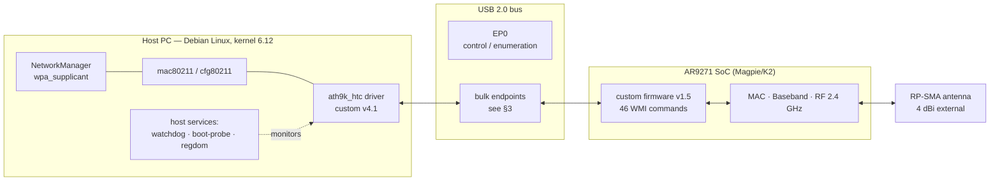
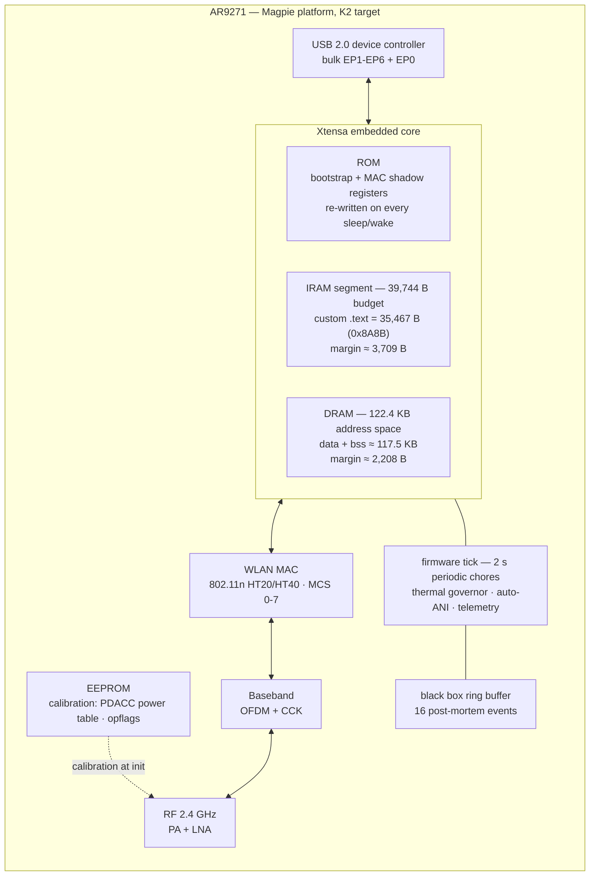
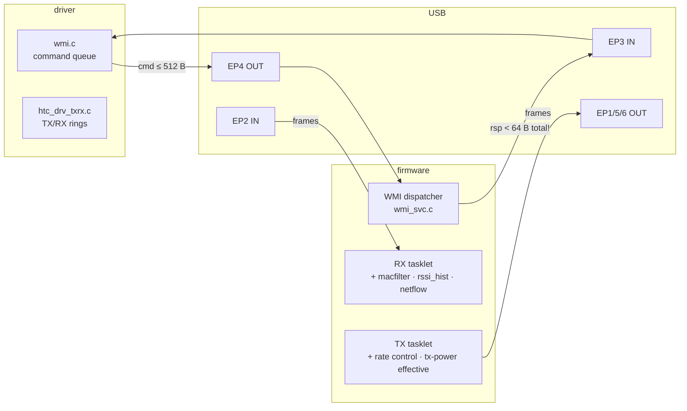
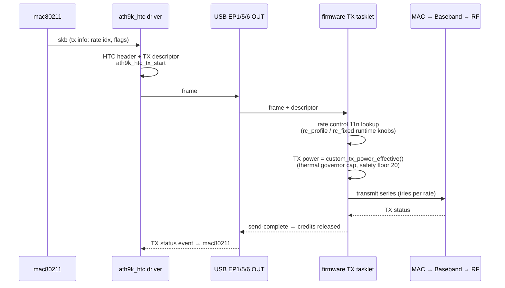
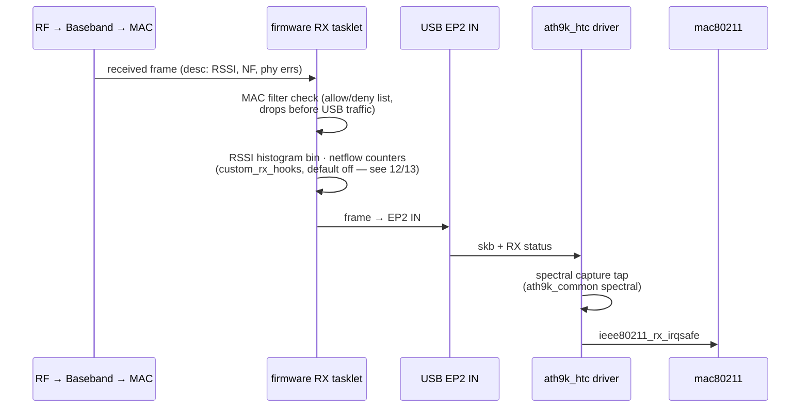
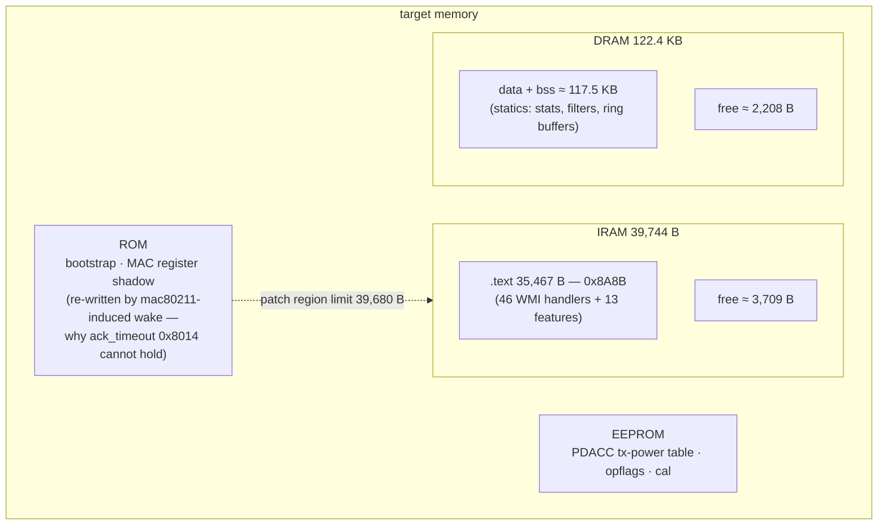

# 🧩 AR9271 Chip Diagrams — Functional Architecture (English)

> **Scope:** functional architecture of the Qualcomm Atheros **AR9271** as used by this project — verified against the
> driver/firmware source trees in [`sources/`](../patches/) and live measurements (`usbmon`, debugfs, dmesg) documented in
> [10](10-debug-session-log.md), [13](13-wmi-wedge-root-cause.md) and [14](14-stability-pass-final-20261115.md).
> **Arabic version:** [16-chip-diagrams-ar.md](16-chip-diagrams-ar.md)
>
> ℹ️ Board-level schematics (PCB, PA matching, antenna network) are TP-Link proprietary and not published — these diagrams
> cover the chip and firmware/driver architecture instead. All diagrams are [Mermaid](https://mermaid.js.org/) and render
> natively on GitHub.

**Chip identity:** Qualcomm Atheros AR9271 — 802.11 b/g/n 1×1, 2.4 GHz only, USB 2.0 device (`0cf3:1006`),
firmware-resident SoC (no host-side MAC). Internal platform codename **Magpie** (`PROJECT_MAGPIE` in the firmware source);
firmware target name **K2** (`k2_HIF_usb_patch.c`, register docs in [13](13-wmi-wedge-root-cause.md)).
The embedded core is an **Xtensa** processor running the open-ath9k-htc-firmware (our custom build: v1.5, 51,144 bytes).

---

## 1) System overview — host to air



---

## 2) AR9271 SoC internal blocks



Memory budget measured on our builds (docs [8](08-firmware-resident-features.md), [12](12-thermal-batch.md), [13](13-wmi-wedge-root-cause.md)):
every new firmware feature is budgeted against the **IRAM margin (≈3.7 KB)** — this is why the airtime feature stays deferred.

---

## 3) USB endpoint map

Verified from: firmware `hif_usb.h` pipe table, driver `htc_drv_init.c` service list, and **usbmon capture** of the WMI
wedge ([13](13-wmi-wedge-root-cause.md)).

| USB endpoint | Direction | Carries | Verified by |
|---|---|---|---|
| EP0 | bidir | USB control / enumeration, `usbreset` | standard |
| **EP4 OUT** | host → target | **WMI commands** (HIF `PIPE_COMMAND` = 4, max msg 512 B on K2) | usbmon `SUB-OUT ep4` |
| **EP3 IN** | target → host | **WMI responses + credit/interrupt reports** (HIF pipe 3) — *total wire size must stay < 64 B, see §6* | usbmon `RCV-IN ep3` |
| EP2 IN | target → host | WLAN RX frames (HIF `PIPE_RX` = 2; firmware sends via HTC `RX_ENDPOINT_ID`) | fw source `if_ath.c:69` |
| EP1 / EP5 / EP6 OUT | host → target | WLAN TX pipes (HIF `TX` = 1, `HP_TX` = 5, `MP_TX` = 6) — beacon / CAB / mgmt / data-QoS services | fw `hif_usb.h` |

HTC services negotiated at init (driver `htc_drv_init.c` — 9 services, 33 credits):
WMI control · beacon · CAB · UAPSD · mgmt · data BE/BK/VI/VO. Endpoint↔pipe mapping is negotiated in the HTC
connect/config-pipe exchange at init; the two rows above are pinned by live usbmon evidence.



---

## 4) TX path — host to air



Custom firmware hooks touched in this path (all runtime-tunable, [7](07-feature-port-roadmap.md), [12](12-thermal-batch.md)):
`txpower` (PDACC index override), `rc_profile` (tries/rate series), `rc_fixed` (fixed-rate toggle),
thermal governor (link-quality cap 48 / weak cap 60 / manual cap / load backoff — bit1 off by default).

---

## 5) RX path — air to host



The RX-side custom hooks default **off** (`custom_rx_hooks=0`) — the stable baseline. The "dies after ~2 custom replies"
mystery that forced this off was root-caused and **fixed** ([13](13-wmi-wedge-root-cause.md)): it was never the hooks,
it was 64-byte WMI control packets wedging the USB controller (§6).

---

## 6) WMI command round-trip — and the 64-byte rule

```mermaid
sequenceDiagram
    participant D as driver (wmi.c)
    participant T as target (wmi_svc.c → handler)
    autonumber
    D->>T: WMI cmd on EP4 OUT (HTC+WMI header + payload)
    T->>T: dispatch by cmd ID<br/>custom IDs 0x21-0x2F
    T-->>D: response on EP3 IN<br/>HTC hdr + WMI hdr + payload + credit trailer
    D->>D: wmi_diag: issued − timeouts = replies
    Note over D,T: ⚠️ RULE: total EP3 packet &lt; 64 B on the wire.<br/>Exactly 64 B wedges the USB controller —<br/>reply reaches the host, then EP4 stops ACKing and<br/>EP3 floods EOVERFLOW every ~2 ms (usbmon-proven).<br/>Firmware caps the credit trailer (≤ 60 B, HTC_EP3_SAFE_PACKET).
```

The three commands that historically crossed the limit (rssi_hist 48-bin, chan_survey s16-NF, netflow) were all
shrunk in firmware **and** driver together ([13](13-wmi-wedge-root-cause.md), fixes 1-3) — zero WMI timeouts since.

---

## 7) Firmware memory map (custom build v1.5)



Binary: `htc_9271-1.dev.0.fw` = **51,144 bytes** (loaded with `use_dev_fw=1`, custom slot — stock `htc_9271-1.4.0.fw` untouched).

---

## 8) Where each feature lives

| Feature | Lives in | debugfs interface | Doc |
|---|---|---|---|
| Custom WMI ping | firmware + driver | `custom_ping` | [13](13-wmi-wedge-root-cause.md) |
| Rate-control profiles / fixed rate | firmware | `rc_profile` / `rc_fixed` | [7](07-feature-port-roadmap.md) |
| TX power override (PDACC) | firmware | `txpower` | [7](07-feature-port-roadmap.md) |
| Rate usage + time-on-air | firmware RC | `rate_usage` | [8](08-firmware-resident-features.md) |
| Reverse telemetry event (0x1008) | firmware → driver | `telemetry` | [8](08-firmware-resident-features.md) |
| Auto-ANI v2 (firstep + CCA ±3 dB) | firmware tick | `ani_auto` | [8](08-firmware-resident-features.md), [9](09-firmware-v3-batch.md) |
| RSSI histogram (64 bins) | firmware RX hook | `rssi_hist` | [8](08-firmware-resident-features.md) |
| Radio-side MAC filter | firmware RX tasklet | `macfilter` | [8](08-firmware-resident-features.md) |
| Block-ACK window (1-64) | firmware | `baw` | [9](09-firmware-v3-batch.md) |
| ACK timeout (0x8014) | firmware reg-write | `ack_timeout` (does not hold — see [13](13-wmi-wedge-root-cause.md)) | [9](09-firmware-v3-batch.md) |
| Channel NF survey | firmware + driver notify | `chan_survey` | [9](09-firmware-v3-batch.md) |
| Mini-netflow (6 MACs) | firmware RX hook | `netflow` | [9](09-firmware-v3-batch.md) |
| Auto-spectral on PHY-error burst | firmware | `auto_spectral` | [9](09-firmware-v3-batch.md) |
| Black box (16 events) | firmware | `blackbox` | [9](09-firmware-v3-batch.md) |
| Thermal governor + cap | firmware tick (2 s) | `thermal` | [12](12-thermal-batch.md) |
| Spectral scan (FFT 56 bins) | driver `ath9k_common` + HW | `spectral_scan0` + ctl | [7](07-feature-port-roadmap.md) |
| NF live read (AR9280 mask, v4.1) | driver reg-read via WMI | `nf` | [14](14-stability-pass-final-20261115.md) |
| WMI diagnostics | driver | `wmi_diag` | [13](13-wmi-wedge-root-cause.md) |
| Hang watchdog (recover ladder) | host systemd | `ath9k-watchdog.service` | [14](14-stability-pass-final-20261115.md) |

---

📅 Generated from the project's own source trees + live measurements, 2026-11-15 · kernel 6.12.117 · firmware 1.5 (51,144 B) · driver v4.1
