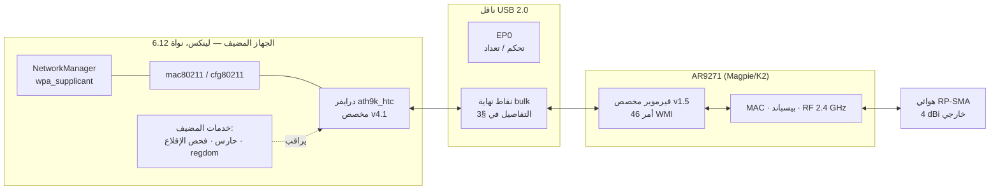
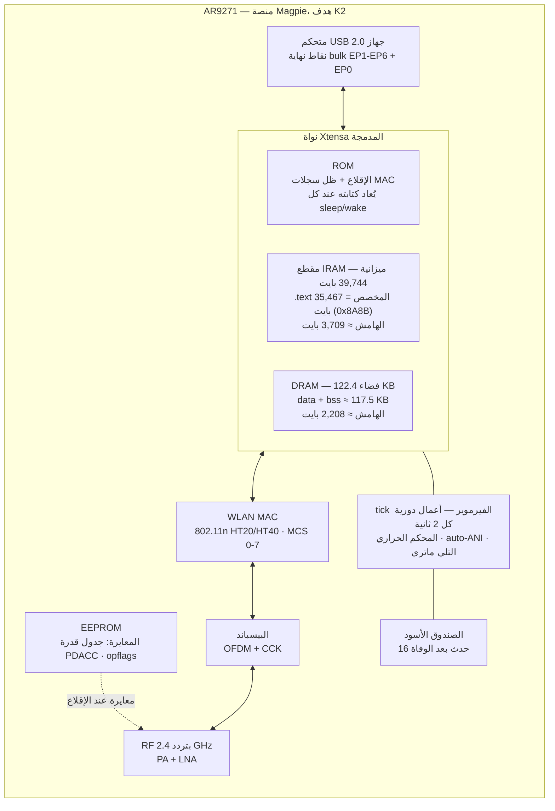
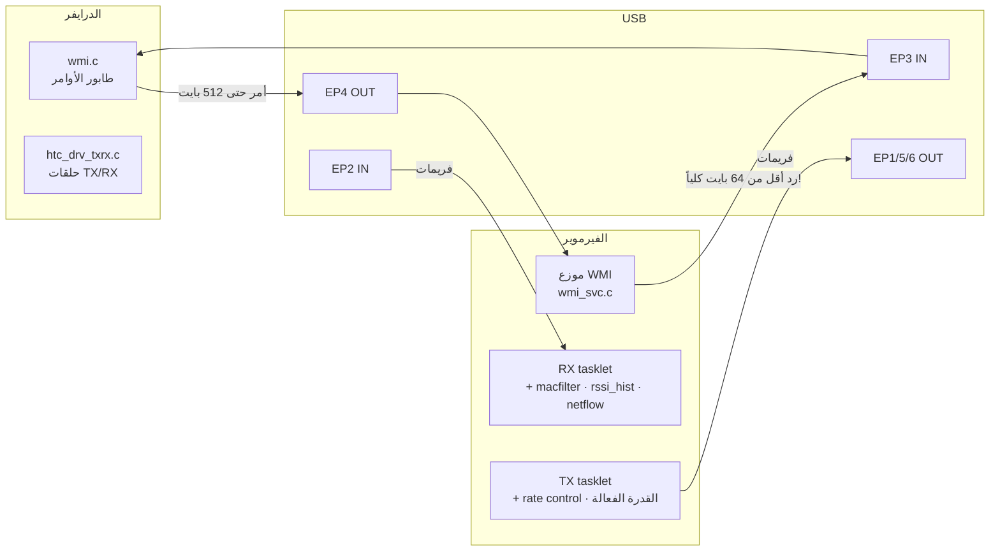
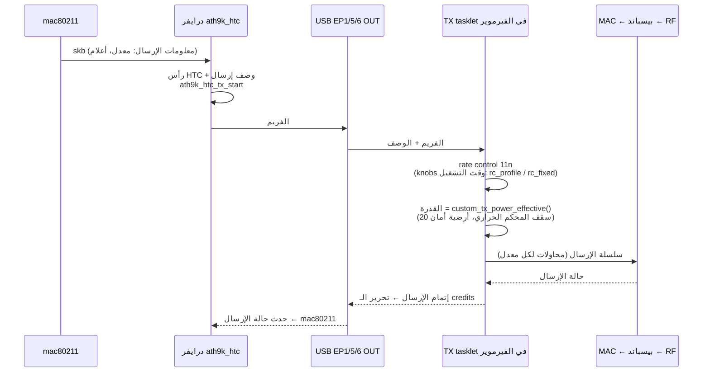
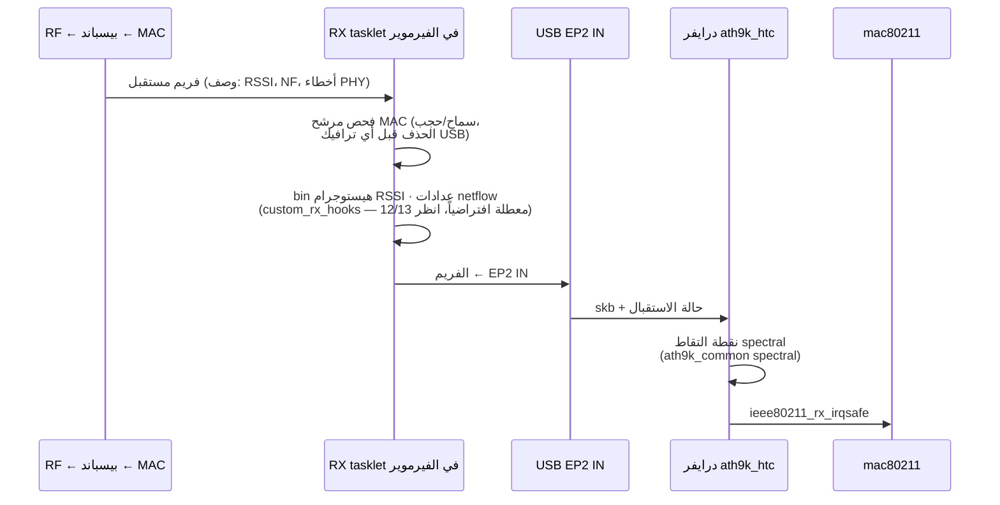
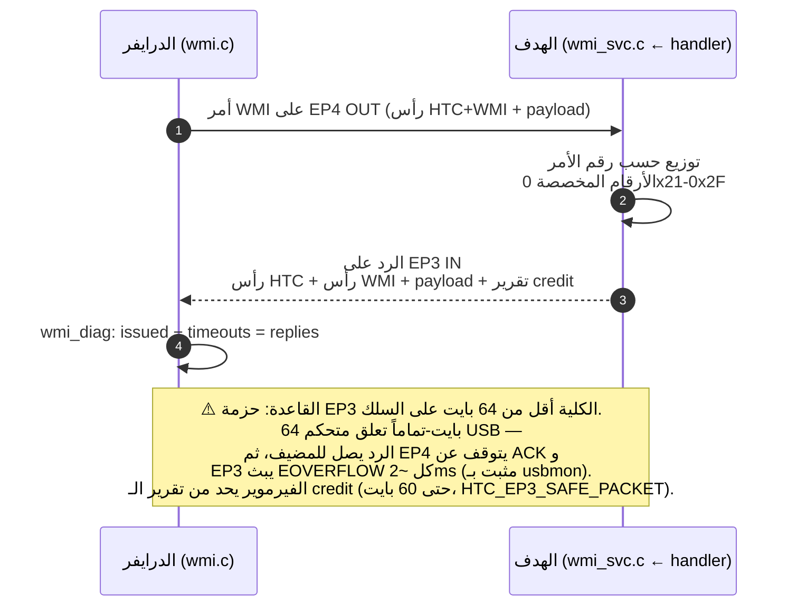
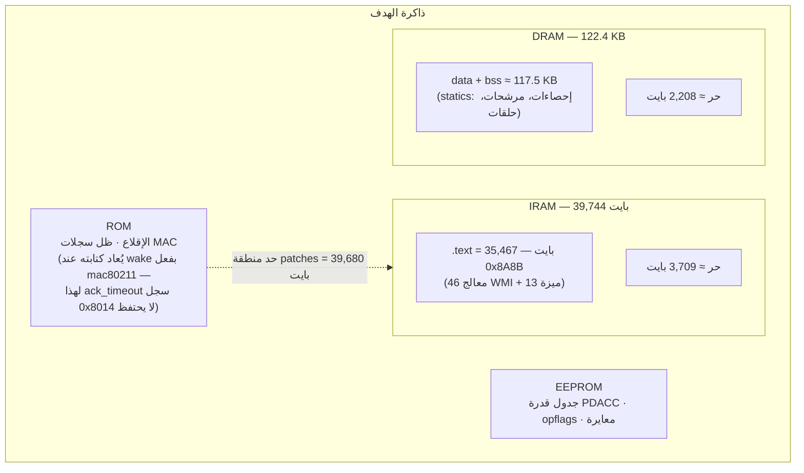

# 🧩 مخططات شريحة AR9271 — البنية الوظيفية (العربية)

> **النطاق:** البنية الوظيفية لشريحة **Qualcomm Atheros AR9271** كما استخدمها هذا المشروع — تم التحقق منها من شجرتَي
> سورس الدرايفَر والفيرموير (الموجودة في الـ [`patches/`](../patches/)) ومن القياسات الحية (`usbmon` وdebugfs وdmesg)
> الموثقة في [10](10-debug-session-log.md) و[13](13-wmi-wedge-root-cause.md) و[14](14-stability-pass-final-20261115.md).
> **النسخة الإنجليزية:** [15-chip-diagrams-en.md](15-chip-diagrams-en.md)
>
> ℹ️ مخططات مستوى اللوحة (PCB ومطابقة الـ PA وشبكة الهوائي) ملكية خاصة لـ TP-Link وغير منشورة — لذلك المخططات هنا تغطي
> الشريحة وبنية الفيرموير/الدرايفر. كل المخططات بصيغة [Mermaid](https://mermaid.js.org/) وتظهر مباشرة على GitHub.

**هوية الشريحة:** Qualcomm Atheros AR9271 — 802.11 b/g/n 1×1، تردد 2.4 GHz فقط، واجهة USB 2.0 (`0cf3:1006`)،
SoC يعمل بفيرموير مقيم داخل الشريحة (لا MAC على الجهاز المضيف). الاسم الكودي للمنصة داخلياً **Magpie**
(`PROJECT_MAGPIE` في سورس الفيرموير) واسم الهدف **K2** (`k2_HIF_usb_patch.c`، وسجلاته في [13](13-wmi-wedge-root-cause.md)).
النواة المدمجة معالج **Xtensa** يشغّل open-ath9k-htc-firmware (بناؤنا المخصص: v1.5 بحجم 51,144 بايت).

---

## 1) نظرة عامة — من الجهاز المضيف إلى الهواء

---

## 2) كتل شريحة AR9271 الداخلية

ميزانية الذاكرة مقاسة على بناؤنا (docs [8](08-firmware-resident-features.md) و[12](12-thermal-batch.md) و[13](13-wmi-wedge-root-cause.md)):
أي ميزة فيرموير جديدة تُقاس ضد **هامش الـ IRAM (≈3.7 KB)** — وهذا سبب بقاء ميزة airtime مؤجلة.

---

## 3) خريطة نقاط نهاية USB

المصادر: جدول pipes في فيرموير `hif_usb.h`، قائمة خدمات الدرايفَر `htc_drv_init.c`، وتصوير **usbmon** الحي
للـ wedge ([13](13-wmi-wedge-root-cause.md)).

| نقطة النهاية | الاتجاه | تحمل | الإثبات |
|---|---|---|---|
| EP0 | ثنائي | تحكم USB / التعداد، `usbreset` | معياري |
| **EP4 OUT** | مضيف → شريحة | **أوامر WMI** (HIF `PIPE_COMMAND` = 4، أقصى رسالة 512 بايت على K2) | usbmon `SUB-OUT ep4` |
| **EP3 IN** | شريحة → مضيف | **ردود WMI + تقارير الـ credit/المقاطعات** (HIF pipe 3) — *طول الحزمة الكلي على السلك لازم يبقى أقل من 64 بايت، انظر §6* | usbmon `RCV-IN ep3` |
| EP2 IN | شريحة → مضيف | فريمات WLAN RX (HIF `PIPE_RX` = 2؛ الفيرموير يرسل عبر نقطة نهاية HTC المخصصة للاستقبال) | سورس الفيرموير `if_ath.c:69` |
| EP1 / EP5 / EP6 OUT | مضيف → شريحة | pipes إرسال WLAN (HIF `TX` = 1، `HP_TX` = 5، `MP_TX` = 6) — خدمات البيكون / CAB / الإدارة / بيانات-QoS | فيرموير `hif_usb.h` |

خدمات HTC التي تتفاوض عند الإقلاع (الدرايفر `htc_drv_init.c` — 9 خدمات، 33 credit):
WMI control · beacon · CAB · UAPSD · mgmt · بيانات BE/BK/VI/VO. ربط النقاط↔الـpipes يتم في تبادل
HTC connect/config-pipe عند الإقلاع؛ الصفان المميزان أعلاه مثبتان بدليل usbmon حي.

---

## 4) مسار الإرسال — من المضيف إلى الهواء

خطافات الفيرموير المخصصة في هذا المسار (كلها قابلة للضبط وقت التشغيل، [7](07-feature-port-roadmap.md) و[12](12-thermal-batch.md)):
`txpower` (تجاوز فهرس PDACC)، `rc_profile` (سلسلة المحاولات/المعدلات)، `rc_fixed` (معدل ثابت)،
المحكم الحراري (سقف حسب جودة الرابط 48 / سقف الضعيف 60 / سقف يدوي / تراجع الحمل — bit1 معطل افتراضياً).

---

## 5) مسار الاستقبال — من الهواء إلى المضيف

الخطافات المخصصة في جانب الاستقبال **معطلة افتراضياً** (`custom_rx_hooks=0`) — الـ baseline المستقر.
لغز "يموت بعد ~2 رد مخصص" الذي فرض هذا التعطيل اتحسم جذرياً **واتصلح** ([13](13-wmi-wedge-root-cause.md)):
لم يكن الخطافات أبداً — كان حزم WMI control بطول 64 بايت بالضبط تعلق متحكم USB (§6).

---

## 6) رحلة أمر WMI ذهاباً وإياباً — وقاعدة الـ 64 بايت

الأوامر الثلاثة التي تجاوزت الحد تاريخياً (rssi_hist بـ 48-bin، chan_survey بـ NF s16، netflow) صغُرت كلها
في الفيرموير **والدرايفر معاً** ([13](13-wmi-wedge-root-cause.md)، إصلاحات 1-3) — صفر WMI timeouts منذ ذلك الحين.

---

## 7) خريطة ذاكرة الفيرموير (بناء مخصص v1.5)

الملف الثنائي: `htc_9271-1.dev.0.fw` = **51,144 بايت** (يُحمَّل بـ `use_dev_fw=1`، خانة dev المخصصة — الأصلي `htc_9271-1.4.0.fw` لا يُمس).

---

## 8) أين تسكن كل ميزة

| الميزة | تسكن في | واجهة debugfs | الوثيقة |
|---|---|---|---|
| Custom WMI ping | فيرموير + درايفر | `custom_ping` | [13](13-wmi-wedge-root-cause.md) |
| بروفايلات rate control / معدل ثابت | فيرموير | `rc_profile` / `rc_fixed` | [7](07-feature-port-roadmap.md) |
| تجاوز قدرة الإرسال (PDACC) | فيرموير | `txpower` | [7](07-feature-port-roadmap.md) |
| عدادات المعدلات + time-on-air | فيرموير RC | `rate_usage` | [8](08-firmware-resident-features.md) |
| حدث التلي ماتري المعكوس (0x1008) | فيرموير ← درايفر | `telemetry` | [8](08-firmware-resident-features.md) |
| Auto-ANI v2 (firstep + CCA ±3 dB) | tick الفيرموير | `ani_auto` | [8](08-firmware-resident-features.md)، [9](09-firmware-v3-batch.md) |
| هيستوجرام RSSI (64 bin) | خطاف RX بالفيرموير | `rssi_hist` | [8](08-firmware-resident-features.md) |
| مرشح MAC في الراديو | RX tasklet بالفيرموير | `macfilter` | [8](08-firmware-resident-features.md) |
| نافذة Block-ACK (1-64) | فيرموير | `baw` | [9](09-firmware-v3-batch.md) |
| ACK timeout (0x8014) | كتابة ريجيستر بالفيرموير | `ack_timeout` (لا يحتفظ — انظر [13](13-wmi-wedge-root-cause.md)) | [9](09-firmware-v3-batch.md) |
| مسح NF لكل قناة | فيرموير + إبلاغ الدرايفر | `chan_survey` | [9](09-firmware-v3-batch.md) |
| Mini-netflow (6 MACs) | خطاف RX بالفيرموير | `netflow` | [9](09-firmware-v3-batch.md) |
| Auto-spectral عند انفجار أخطاء PHY | فيرموير | `auto_spectral` | [9](09-firmware-v3-batch.md) |
| الصندوق الأسود (16 حدث) | فيرموير | `blackbox` | [9](09-firmware-v3-batch.md) |
| المحكم الحراري + السقف | tick الفيرموير (كل 2 ثانية) | `thermal` | [12](12-thermal-batch.md) |
| Spectral scan (FFT بـ 56 bin) | درايفر `ath9k_common` + هاردوير | `spectral_scan0` + ctl | [7](07-feature-port-roadmap.md) |
| قراءة NF الحية (ماسك AR9280، v4.1) | قراءة ريجيستر بالدرايفر عبر WMI | `nf` | [14](14-stability-pass-final-20261115.md) |
| تشخيصات WMI | درايفر | `wmi_diag` | [13](13-wmi-wedge-root-cause.md) |
| حارس التعليق (سلّم الاسترجاع) | systemd على المضيف | `ath9k-watchdog.service` | [14](14-stability-pass-final-20261115.md) |

---

📅 مُولَّد من شجرتَي سورس المشروع نفسها + قياسات حية، 2026-11-15 · نواة 6.12.117 · فيرموير 1.5 (51,144 بايت) · درايفر v4.1
